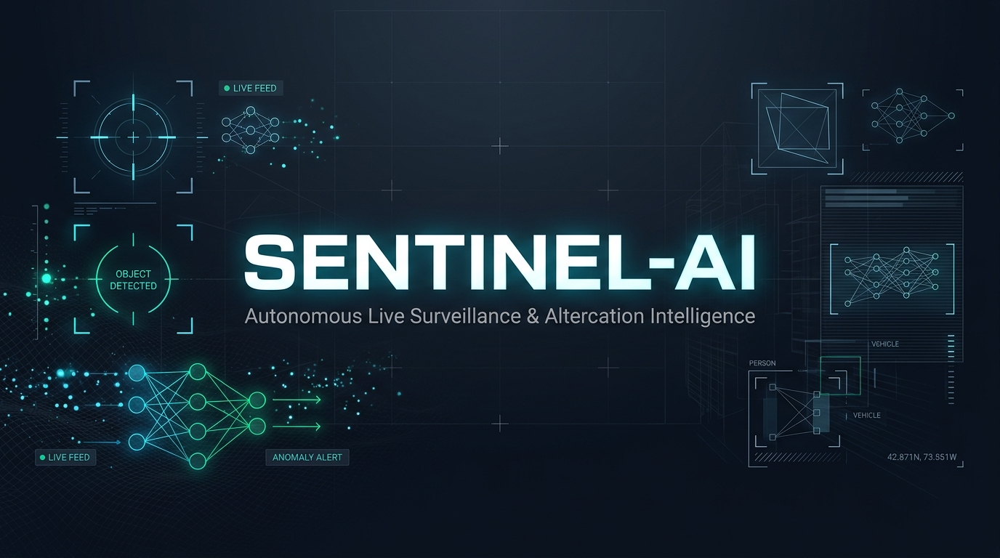
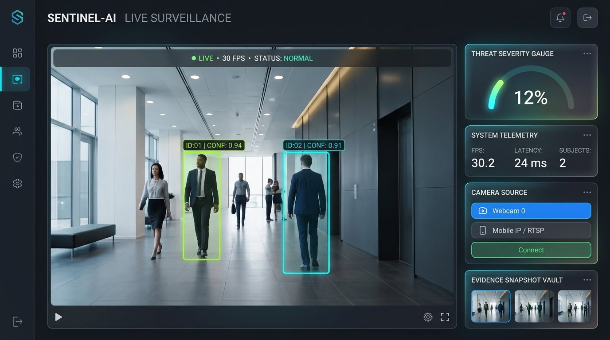
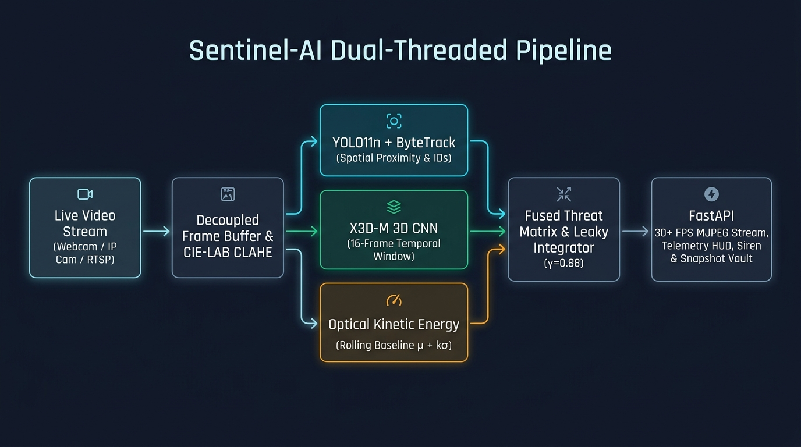
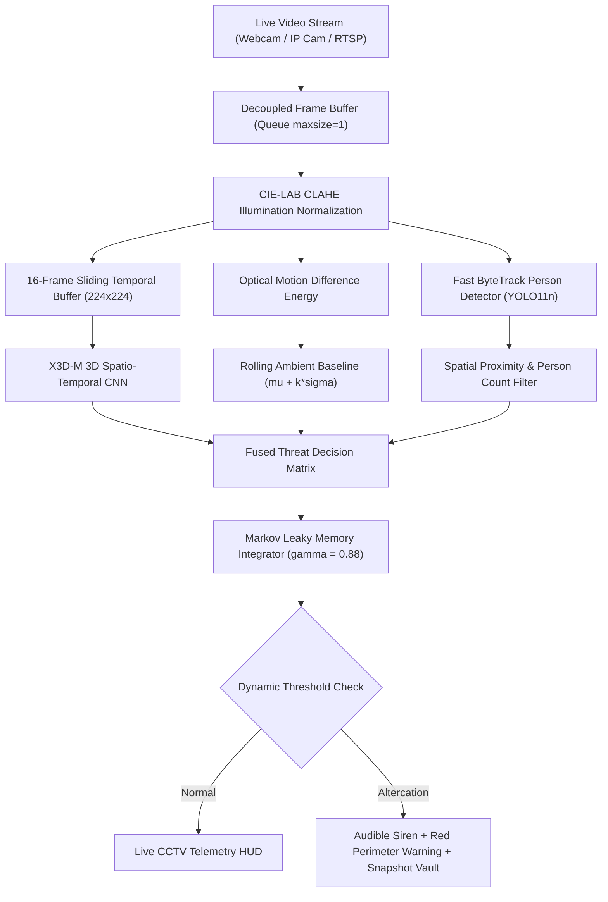

<p align="center">
  
</p>

<h1 align="center">Sentinel-AI: Autonomous Live Surveillance &amp; Altercation Intelligence</h1>

<p align="center">
  Real-time multi-subject tracking, 3D spatio-temporal violence recognition, and low-latency CCTV command telemetry powered by <b>YOLO11n + ByteTrack</b>, <b>X3D-M 3D CNN</b>, and <b>FastAPI</b>.
</p>

<p align="center">
  
  
  
  
  
  
</p>

---

## Executive Summary

**Sentinel-AI** is a low-latency, real-time automated surveillance and physical altercation detection platform engineered for **USB webcams, live CCTV feeds, and mobile IP camera streams (DroidCam / IP Webcam / RTSP)**.

Instead of relying on slow post-hoc video upload workflows, Sentinel-AI runs a **decoupled dual-threaded inference engine**:
- **Streaming Thread (30+ FPS):** Delivers fluid, zero-lag MJPEG video to a tactical web command dashboard.
- **Asynchronous AI Worker:** Combines **Ultralytics YOLO11n + ByteTrack** multi-person spatial proximity tracking with an **X3D-M 3D Convolutional Neural Network** and **optical kinetic energy baseline filtering** to detect altercations as they unfold.

---

## Surveillance Command Dashboard & Live Previews

<p align="center">
  
</p>

<div align="center">
  <table>
    <tr>
      <td align="center"><b>Normal Monitoring HUD (ByteTrack)</b></td>
      <td align="center"><b>Altercation Alert (Red Perimeter + Evidence Vault)</b></td>
    </tr>
    <tr>
      <td></td>
      <td></td>
    </tr>
  </table>
</div>

---

## System Architecture & Signal Processing Pipeline

<p align="center">
  
</p>



### Mathematical Foundations

1. **CIE-LAB Illumination Invariance (CLAHE)**  
   To remain robust across shadows, flickering indoor lighting, and low-light environments, frames are converted to CIE-LAB and Contrast-Limited Adaptive Histogram Equalization is applied strictly to the luminance channel ($L^*$):
   $$L^*_{\text{equalized}} = \text{CLAHE}(L^*, \text{clipLimit}=2.0, \text{grid}=(8,8))$$

2. **Rolling Ambient Baseline ($z$-Score Kinetic Filter)**  
   Ambient scene motion (trees, background foot traffic, sensor noise) is modeled via a rolling kinetic mean $\mu$ and standard deviation $\sigma$ over recent frames:
   $$z_{\text{kinetic}} = \max\left(0, \frac{E_{\text{kinetic}} - \mu_{\text{ambient}}}{\sigma_{\text{ambient}} + \epsilon}\right), \qquad \text{Relative Kinetic Score} = \min\left(1.0, \frac{z_{\text{kinetic}}}{3.5}\right)$$

3. **Long-Horizon Leaky Threat Integrator**  
   Intermittent pauses during a physical scuffle should not prematurely clear an active threat. Threat probability is retained via a recursive Markov leaky decay state:
   $$M_t = \gamma \cdot M_{t-1} + (1 - \gamma) \cdot P_{\text{instantaneous}} \quad (\gamma = 0.88)$$
   $$\text{Effective Threat} = \max\left(P_{\text{instantaneous}}, M_t\right)$$

---

## Core Engineering & UI Features

### Pipeline & Reliability
1. **Zero-Lag Decoupled Producer-Consumer Engine:** Camera capture and MJPEG rendering execute independently from PyTorch inference so live video stays responsive at 30+ FPS.
2. **PyTorch 2.x Safe Globals & 5D Tensor Pipeline:** Registers NumPy safe globals and formats `(1, C, T, H, W)` 16-frame spatio-temporal clips cleanly for X3D-M inference.
3. **ByteTrack Multi-Subject Tracking:** Assigns persistent tracking IDs with crisp bounding overlays and minimal HUD clutter.
4. **Dual-Stage Spatial Proximity Filter:** Pairs multi-person spatial proximity (`MIN_PROXIMITY_PERSON_COUNT = 2`) with consecutive X3D alert windows (`CONSECUTIVE_ALERT_WINDOWS = 2`) to curb false alarms.
5. **Resilient Auto-Reconnect Stream Manager:** Recovers gracefully from Wi-Fi dropouts on mobile IP feeds and supports a built-in `sample` stream fallback.

### Tactical Dashboard & Operator Experience
6. **Glassmorphic Dark-Mode Surveillance Dashboard:** Command-center interface served via FastAPI (`web/dashboard.html`).
7. **Universal Camera Source Switcher:** Live switching between local webcams (`0`, `1`), mobile IP/RTSP streams, and the sample simulator without restarting the server.
8. **Automated Snapshot Evidence Vault:** Captures and serves timestamped incident evidence images under `snapshots/`.
9. **Live Telemetry & Threat Severity Gauge:** Streams real-time FPS, inference latency (ms), active person count, and threat score via `/api/telemetry`.
10. **Audio-Visual Alarm System:** Synthesizes an audible emergency alert with a perimeter warning flash when an altercation is confirmed.

---

## Project Structure

```text
Sentinel-AI/
├── assets/                          # README visuals, architecture diagram & previews
├── core/
│   ├── config.py                    # Model paths, thresholds & server settings
│   ├── detector.py                  # YOLO11n + ByteTrack person tracking & proximity
│   ├── fight_classifier.py          # X3D-M 3D CNN, CLAHE & leaky threat memory
│   ├── pipeline.py                  # Dual-threaded capture, inference & snapshot loop
│   └── stream_manager.py            # Resilient webcam / IP cam / sample stream handler
├── web/
│   ├── app.py                       # FastAPI server, MJPEG feed & REST endpoints
│   └── dashboard.html               # Tactical dark-mode surveillance UI
├── Sentinel-AI/                     # Core model weights & legacy engine modules
├── snapshots/                       # Saved altercation evidence snapshots
├── download_model.py                # Downloads final_x3d_realtime.pt from Hugging Face
├── run.py                           # Unified CLI launcher
├── start_sentinel.bat               # Windows one-click launcher
├── requirements.txt                 # Python dependencies
├── FEATURES.md                      # Detailed feature breakdown
└── LICENSE                          # MIT License
```

---

## Quickstart Guide

### Prerequisites
- Windows 10/11 or Linux
- Python 3.10 – 3.13
- Webcam, USB camera, or mobile phone on the same Wi-Fi network (optional GPU with CUDA for faster inference)

### 1. Clone & Set Up Environment
```bash
git clone https://github.com/dhruva77vernekar-hub/Sentinal-Ai.git
cd Sentinal-Ai

python -m venv .venv
# Windows:
.venv\Scripts\activate
# Linux / macOS:
source .venv/bin/activate

pip install -r requirements.txt
```

### 2. Download Model Checkpoints
Download the fine-tuned X3D-M checkpoint (`final_x3d_realtime.pt`) from Hugging Face Hub (`visionlab-ai/school-violence-detection-models`):
```bash
python download_model.py
```

### 3. Launch Sentinel-AI
On Windows, double-click `start_sentinel.bat` or start from the terminal:
```bash
python run.py
```
Optional CLI flags:
```bash
python run.py --camera 0 --port 7860
python run.py --camera "http://192.168.1.100:8080/video" --host 0.0.0.0 --port 7860
```
Open **http://127.0.0.1:7860** in your browser (or `http://<your-lan-ip>:7860` from another device on the same network).

---

## Connecting a Mobile Camera (IP Webcam / DroidCam)

1. Install **IP Webcam** (Android) or **DroidCam** (iOS/Android).
2. Connect your phone and PC to the same Wi-Fi network.
3. Start the stream server on your phone and note the displayed URL (e.g., `http://192.168.1.100:8080`).
4. Paste `http://192.168.1.100:8080/video` into the **Camera Source** field on the dashboard and click **Connect**.

---

## Configuration Reference (`core/config.py`)

| Parameter | Default | Description |
| :--- | :--- | :--- |
| `DEFAULT_CAMERA_SOURCE` | `"sample"` | Initial feed (`"sample"`, camera index, or stream URL) |
| `FRAME_WIDTH` / `FRAME_HEIGHT` | `640` / `480` | Capture frame dimensions |
| `YOLO_CONFIDENCE` | `0.35` | Minimum YOLO11n person detection confidence |
| `X3D_NUM_FRAMES` / `X3D_FRAME_SIZE` | `16` / `224` | Temporal clip length and spatial input size for X3D-M |
| `X3D_THRESHOLD` | `0.40` | Calibrated altercation probability threshold |
| `CONSECUTIVE_ALERT_WINDOWS` | `2` | Sustained windows required before triggering alarm |
| `MIN_PROXIMITY_PERSON_COUNT` | `2` | Minimum proximate subjects for spatial altercation check |
| `WEB_HOST` / `WEB_PORT` | `"0.0.0.0"` / `7860` | FastAPI server bind address and port |

---

## REST API & Streaming Endpoints

| Endpoint | Method | Description |
| :--- | :---: | :--- |
| `/` | `GET` | Tactical Surveillance Dashboard HTML |
| `/video_feed` | `GET` | Decoupled 30+ FPS MJPEG live camera stream |
| `/api/telemetry` | `GET` | Real-time JSON telemetry (`fps`, `latency_ms`, `person_count`, `threat_score`, `risk_level`, `is_alarm`) |
| `/api/camera` | `POST` | Switch active stream (`{"source": "0"}` or `{"source": "http://..."}`) |
| `/api/snapshots` | `GET` | List recorded incident evidence snapshots |
| `/snapshots/{file}` | `GET` | Static file access to saved evidence snapshots |

---

## References & Acknowledgments

- **X3D: Expanding Architectures for Efficient Video Recognition** — Christoph Feichtenhofer (CVPR 2020)
- **ByteTrack: Multi-Object Tracking by Associating Every Detection Box** — Yifu Zhang et al. (ECCV 2022)
- **Ultralytics YOLO11** — Ultralytics Inc.
- **PyTorchVideo** — Meta AI Research
- Upstream repository base & MIT License attribution preserved in [LICENSE](LICENSE)

---

## License

This project is licensed under the **MIT License** — see the [LICENSE](LICENSE) file for details.
